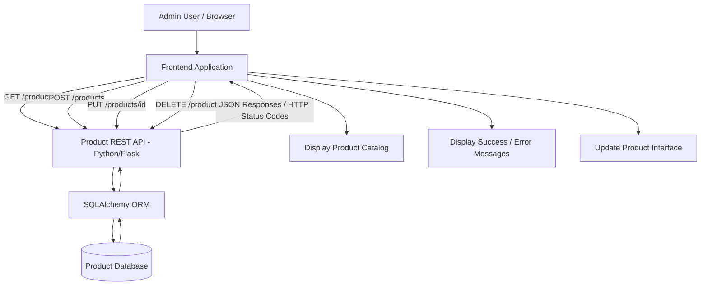
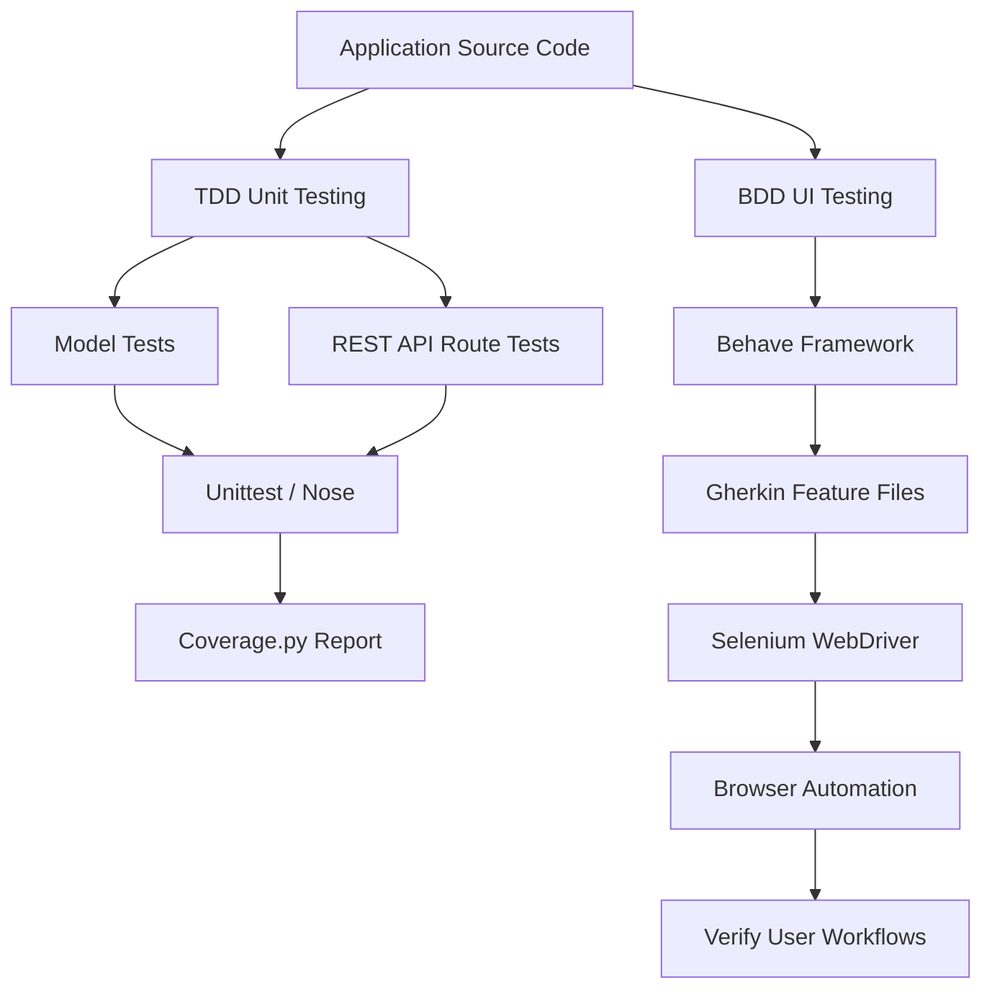
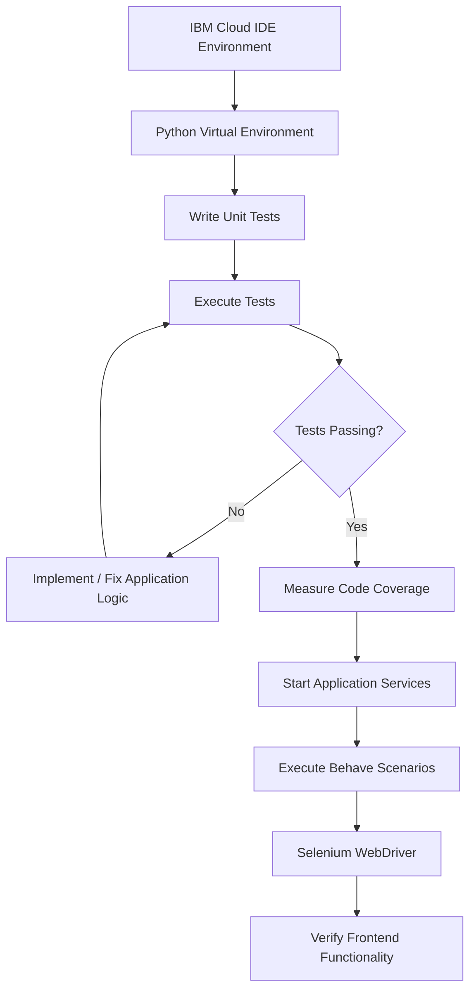

# IBM Cloud IDE – Product Catalog Microservice (TDD & BDD)


## Project Overview

This project demonstrates the development, integration, and testing of a **microservices-based Product Catalog Application** using an IBM Cloud IDE environment with Docker.

The application allows administrators to manage an e-commerce product catalog through an interactive web interface. Administrators can create, retrieve, update, delete, and search products based on different attributes.

The application consists of two main components:

- **Product REST API Microservice (Python):** A Flask-based backend service implementing complete Create, Read, Update, Delete (CRUD) functionality. SQLAlchemy is used for database modelling and persistence. The backend was developed using Test-Driven Development (TDD), with unit tests written before implementing application functionality.
- **Administrative Frontend (HTML, CSS and JavaScript):** Provides an interactive web interface for managing products. It communicates with the backend through RESTful HTTP requests. The frontend was tested using Behaviour-Driven Development (BDD), Selenium WebDriver and Behave.

The backend service handles product management and database operations, while the frontend provides the interface for administrators to interact with the catalog.

This project provided practical experience with REST API development, database integration, automated testing, browser automation, code coverage and cloud-based development environments.

---

## Project Objectives

The main objectives of this project are:

- Understand microservice development and backend application architecture.
- Develop a Python-based REST API using Flask.
- Implement complete CRUD operations for product management.
- Design database models and relationships using SQLAlchemy.
- Apply Test-Driven Development (TDD) principles.
- Write unit tests before implementing application functionality.
- Achieve a target of over 95% code coverage using Nose and Coverage.py.
- Deploy and manage an ephemeral IBM Cloud IDE environment.
- Work with Docker-based development environments.
- Integrate Selenium WebDriver for browser automation.
- Implement Behaviour-Driven Development (BDD) using Behave.
- Write automated test scenarios using Gherkin syntax.
- Implement step definitions for automated UI interactions.
- Test product creation, retrieval, updating, deletion and search functionality.
- Troubleshoot application execution, database connectivity and testing issues.

---

## Architecture

The application follows a microservices-based architecture consisting of a backend REST API and an administrative frontend connected through HTTP requests.

### Application Architecture



### Testing Architecture



### Development and Testing Workflow



---

## Microservices Description

### 1. Product REST API Microservice – Python (Flask)

Responsible for managing product information and providing REST API endpoints to the administrative frontend.

The backend implements CRUD functionality and supports searching products using different attributes.

**Main API operations:**

| Endpoint | Purpose |
|---|---|
| `GET /products` | Retrieves the complete product catalog |
| `GET /products/<id>` | Retrieves an individual product using its ID |
| `POST /products` | Creates a new product |
| `PUT /products/<id>` | Updates an existing product |
| `DELETE /products/<id>` | Deletes an existing product |

The API also supports searching and filtering products using attributes such as:

- Product name
- Product category
- Product availability

The backend processes HTTP requests, interacts with the database through SQLAlchemy and returns appropriate JSON responses and HTTP status codes.

### 2. Administrative Frontend – HTML, CSS and JavaScript

Provides the administrative interface and coordinates communication with the backend REST API.

**Main responsibilities:**

- Load the complete product catalog when the homepage opens.
- Display products in an interactive table.
- Provide a form to create new products.
- Allow administrators to update existing product information.
- Provide functionality to delete products.
- Search products by name.
- Filter products by category.
- Filter products by availability.
- Display dynamic success and error messages.
- Communicate with the backend using HTTP requests without requiring a complete page refresh.

---

## Frontend-to-Backend Communication

The frontend acts as the interface between administrators and the Product REST API microservice.

The application follows this workflow:

1. The administrator opens the frontend application.
2. The frontend sends an HTTP GET request to retrieve the complete product catalog.
3. The backend processes the request and retrieves product information from the database.
4. The API returns product information in JSON format.
5. The frontend displays the retrieved products in a table.
6. When the administrator creates a product, the frontend sends an HTTP POST request.
7. The backend validates and stores the new product.
8. When an existing product is updated, the frontend sends an HTTP PUT request.
9. When a product is deleted, the frontend sends an HTTP DELETE request.
10. The frontend updates the product list and displays the appropriate success or error message.

**Important architectural detail:** The frontend communicates directly with the Flask REST API. The backend handles database operations through SQLAlchemy, keeping data management separate from the presentation layer.

---

## Repository Structure

The project follows a structured layout separating backend application logic, unit tests and BDD automation.

```text
tdd-bdd-final-project/
│
├── service/
│   ├── __init__.py
│   ├── models.py
│   ├── routes.py
│   └── common/
│       ├── __init__.py
│       └── ...
│
├── tests/
│   ├── __init__.py
│   ├── factories.py
│   ├── test_models.py
│   └── test_routes.py
│
├── features/
│   ├── products.feature
│   └── steps/
│       ├── load_steps.py
│       └── web_steps.py
│
├── bin/
│   └── setup.sh
│
├── README.md
└── .gitignore
```

### Directory Description

| Directory / File | Description |
|---|---|
| `service/` | Contains the main backend application logic |
| `service/models.py` | Defines product database models and ORM operations |
| `service/routes.py` | Implements REST API endpoints |
| `service/common/` | Contains common application utilities and supporting components |
| `tests/` | Contains automated backend unit tests |
| `tests/factories.py` | Generates test data using Faker |
| `tests/test_models.py` | Contains TDD tests for database models |
| `tests/test_routes.py` | Contains TDD tests for REST API endpoints |
| `features/` | Contains BDD feature files |
| `features/products.feature` | Defines product management scenarios using Gherkin |
| `features/steps/` | Contains Behave step definitions |
| `features/steps/load_steps.py` | Handles background data setup for BDD scenarios |
| `features/steps/web_steps.py` | Implements Selenium browser interactions |
| `bin/setup.sh` | Initializes the development environment |
| `README.md` | Project overview and technical documentation |

---

## Technologies and Tools

| Technology | Usage |
|---|---|
| Python 3.8 | Backend development and test automation |
| Flask | REST API implementation |
| SQLAlchemy | Object-relational mapping and database operations |
| SQLite / Configured Database | Product data persistence |
| Unittest | Python unit testing |
| Nose | Automated test execution |
| Coverage.py | Measuring Python code coverage |
| Behave | Behaviour-Driven Development framework |
| Gherkin | Writing human-readable BDD scenarios |
| Selenium WebDriver | Browser automation and UI testing |
| Faker | Generating sample product data |
| HTML5 | Frontend structure |
| CSS3 | Frontend styling |
| JavaScript | Frontend functionality |
| Docker | Containerised development environment |
| IBM Cloud IDE | Cloud-based development environment |
| Git and GitHub | Version control and source code management |

---

# Practical Implementation

## 1. Environment Initialization

Configured the IBM Cloud IDE environment and initialized the Python virtual environment using the provided setup script.

### Run Environment Setup

```bash
bash ./bin/setup.sh
```

The setup script prepares the development environment and installs the required project dependencies.

### Environment Configuration

The development environment provides the tools required to run the Flask application, execute automated tests and perform browser-based testing.

The configured environment includes:

- Python runtime
- Required Python packages
- Application dependencies
- Testing frameworks
- Docker-based development tools

## 2. Test-Driven Development (TDD) – Backend Implementation

Developed the Product REST API using Test-Driven Development.

The TDD approach involves writing unit tests before implementing the corresponding application functionality.

### TDD Development Workflow

1. Identify the required application functionality.
2. Write a unit test for the expected behaviour.
3. Execute the test and observe the initial failure.
4. Implement the required application logic.
5. Execute the test again.
6. Refactor the implementation where necessary.
7. Repeat the process for additional functionality.

### Running Model Tests

Executed the unit tests responsible for validating database models and ORM functionality.

```bash
nosetests tests/test_models.py
```

### Running REST API Route Tests

Executed tests to validate REST API endpoints, request handling and response behaviour.

```bash
nosetests tests/test_routes.py
```

### Running the Complete Test Suite

```bash
nosetests
```

### Checking Code Coverage

Used Coverage.py to measure the percentage of application code executed during testing.

```bash
coverage run -m nose
```

Generate the coverage report:

```bash
coverage report -m
```

The coverage report identifies:

- Total statements
- Executed statements
- Missed statements
- Overall code coverage percentage

**Project target:** More than 95% code coverage.

---

## 3. Behaviour-Driven Development (BDD) – Frontend Testing

Implemented Behaviour-Driven Development to validate the administrative frontend from the perspective of an actual user.

BDD scenarios were written using Gherkin syntax and executed through the Behave framework.

Selenium WebDriver was used to automate browser interactions and validate the application's behaviour.

### BDD Implementation Workflow

1. Define the expected user behaviour.
2. Write feature scenarios using Gherkin syntax.
3. Implement corresponding step definitions.
4. Configure Selenium WebDriver.
5. Execute the scenarios using Behave.
6. Verify the expected results through browser automation.

### Starting the Application Services

```bash
honcho start
```

This command starts the application processes configured for the development environment.

### Running BDD Tests

```bash
behave
```

Behave discovers the feature files, executes the associated step definitions and reports the test results.

---

## 4. BDD Scenarios Tested

Implemented and executed seven BDD scenarios to validate the core product management functionality.

### Scenario 1 – Read a Product

Verified that an administrator can search for a product and retrieve its information.

**Expected behaviour:**
- Search for an existing product.
- Retrieve the matching product.
- Display the correct product information.

### Scenario 2 – Update a Product

Verified that an administrator can modify the details of an existing product.

**Expected behaviour:**
- Select an existing product.
- Update its information.
- Save the changes.
- Verify the updated product details.

### Scenario 3 – Delete a Product

Verified that an administrator can remove an existing product from the catalog.

**Expected behaviour:**
- Select a product.
- Execute the delete operation.
- Verify that the product is removed from the catalog.

### Scenario 4 – List All Products

Verified that the application retrieves and displays all available products.

**Expected behaviour:**
- Open the product catalog.
- Retrieve all product records.
- Display the products in the interface.

### Scenario 5 – Search by Category

Verified that administrators can filter products using their category.

**Expected behaviour:**
- Select or enter a product category.
- Execute the search.
- Display matching products.

### Scenario 6 – Search by Availability

Verified that administrators can filter products according to their availability status.

**Expected behaviour:**
- Select an availability value (`True` or `False`).
- Execute the search.
- Display products matching the selected availability.

### Scenario 7 – Search by Name

Verified that administrators can search for specific products using their names.

**Expected behaviour:**
- Enter a product name.
- Execute the search.
- Display the matching product records.

---

## 5. Automated Testing Strategy

The project uses two complementary testing methodologies.

| Testing Type | Framework / Tool | Purpose |
|---|---|---|
| Unit Testing | Unittest / Nose | Validate individual application components |
| Model Testing | Nose | Verify database models and ORM functionality |
| API Testing | Nose | Validate REST API routes and responses |
| Code Coverage | Coverage.py | Measure executed application code |
| Behaviour Testing | Behave | Validate application behaviour through scenarios |
| Browser Automation | Selenium | Simulate real administrator interactions |
| Test Data Generation | Faker | Generate sample product records |

### TDD vs BDD

| TDD | BDD |
|---|---|
| Test-Driven Development | Behaviour-Driven Development |
| Focuses on application implementation | Focuses on expected application behaviour |
| Tests are generally written in Python | Scenarios are written using Gherkin |
| Uses Nose and Unittest | Uses Behave and Selenium |
| Validates models and API functionality | Validates user-facing workflows |

---

## 6. Practical Skills Demonstrated

Through this project, I gained hands-on experience with:

- Python backend development.
- RESTful API design and implementation.
- Microservice application architecture.
- Database modelling using SQLAlchemy.
- Test-Driven Development.
- Behaviour-Driven Development.
- Automated unit and functional testing.
- Selenium browser automation.
- Gherkin-based test scenario development.
- Code coverage measurement.
- Docker-based development environments.
- Cloud IDE configuration and troubleshooting.
- Software quality assurance and testing workflows.

## Project Significance

This project demonstrates an understanding of software development and quality assurance practices within a cloud-based development environment.

It highlights the importance of automated testing throughout the software development lifecycle, ensuring that application functionality is validated before being considered ready for deployment.

The combination of TDD, BDD, automated testing, Docker and REST API development provides a foundation for understanding how software quality practices integrate into modern DevOps and CI/CD workflows.

---

**Author:** Muhammad Hamza  
**GitHub:** [malikhamza0546](https://github.com/malikhamza0546)
